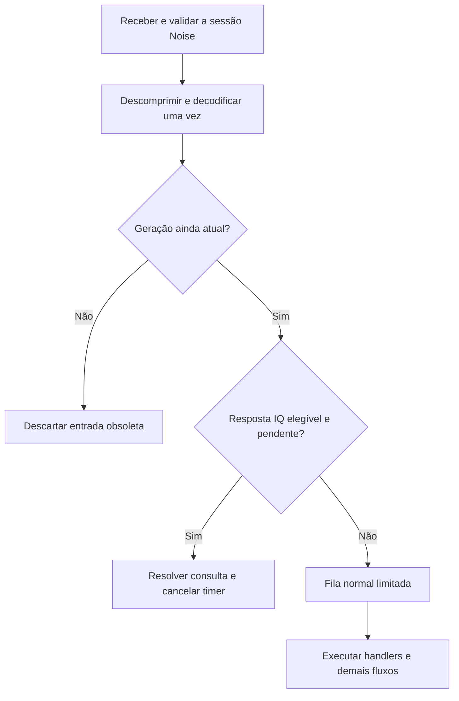

# Plano: progresso de respostas IQ sob saturação da entrada

Status: proposta para implementação. Data: 15/11/2026.
Branch: `chore/upgrade-zapo-1.11-session-safety`. Referência dos testes: `b3b7dd4`.

Este documento explica o problema, a solução proposta, as decisões de compatibilidade e
os critérios para considerar a correção concluída. Não registra uma correção já implementada.
Criar este plano não altera a fila, o banco ou o comportamento do cliente.

## 1. Problema e evidência

`WaComms` admite oito tratamentos simultâneos e 4096 frames aguardando tratamento. Uma vaga
fica ocupada até a Promise do tratamento terminar, inclusive enquanto ele aguarda uma IQ.
As respostas precisam dessa mesma fila para alcançar o correlacionador. Oito tratamentos
aguardando consultas podem, portanto, impedir o processamento das respostas que os liberariam.

O correlacionador já existe: `WaNodeOrchestrator.query()` registra o ID e os callbacks em
`pendingQueries` antes do envio. `tryResolvePending()` encontra o ID, cancela o timer,
remove a entrada e resolve a Promise. O problema é chegar a esse método sob saturação.

A [rodada de TDD](./upgrade-1.11-iq-tdd.md) deixou 21 novos cenários antes de mudar runtime:

- Core: 1386 aprovações, um skip, zero falhas.
- Gate controlado: duas aprovações e cinco falhas de progresso sob saturação.
- Loopback WebSocket/Noise: duas aprovações e duas falhas com oito tratamentos.
- Persistência e upgrade: 17 aprovações.

No loopback, um timeout libera uma vaga e as outras sete consultas conseguem prosseguir.
A conexão permanece aberta nesse ensaio. Isso demonstra o bloqueio, sem provar sua frequência
em produção ou atribuir a ele toda desconexão observada. O problema também foi caracterizado
no fork 1.7.1; não foi introduzido pela persistência do contador.

## 2. Objetivo e limites

Uma resposta válida de IQ pendente deve poder liberar o solicitante mesmo com as oito vagas
ocupadas e a fila normal cheia. A solução deve reutilizar o registro de consultas, preservar
os erros e timeouts legítimos e manter trabalho e memória limitados.

Permanecem fora desta correção: migrações e providers de banco, `loginCounter`, VoIP, política
de publicação de conteúdo, aumento de concorrência e alteração de formatos de protocolo.
Não se remove limpeza de credenciais em logout ou revogação.

## 3. Desenho preferido: preparar, reconhecer, despachar

Separar o trabalho curto de entrada do trabalho que pode aguardar I/O:



O reconhecimento acontece antes de disputar vaga na fila normal. Colocar o teste de ID
dentro da fila atual não remove a dependência circular. Apenas priorizar itens dessa fila
também não ajuda quando todas as vagas já estão ocupadas.

### Regras da fase curta

1. Preservar a ordem da decriptação Noise e seus contadores.
2. Descomprimir e decodificar uma única vez. Não inspecionar bytes com um parser alternativo,
   reencodar o nó ou manter um cache adicional de nós por ID.
3. Validar a identidade/geração da conexão antes e depois de cada `await` da preparação,
   incluindo decriptação, descompressão e decode.
4. Considerar inicialmente apenas `iq` de tipo `result` ou `error`, correspondente a uma
   consulta IQ realmente pendente. Auditar os usos de `query()` para não confundir respostas
   de outros tipos de pedido. Se necessário, guardar o tag do pedido junto ao registro já
   existente, sem criar um segundo mapa de correlação.
5. Resolver pela correlação existente. Não converter um IQ de erro em sucesso de negócio:
   entregar o payload e manter a validação de erro no nível que já a realiza.
6. Deixar requests IQ, IDs desconhecidos/ausentes, duplicatas já consumidas, receipts e
   demais eventos seguirem o tratamento compatível com o dispatcher atual.
7. A fase curta não executa handlers de mensagem, consulta banco, faz chamada de rede ou
   espera a Promise do trabalho normal terminar.

Exemplo ilustrativo da separação, não assinatura definitiva nem código pronto para copiar:

```ts
async function receiveFrame(frame: Uint8Array, generation: number): Promise<void> {
    const node = await decodeFrameOnce(frame)
    if (!node || !isCurrentGeneration(generation)) return

    if (canResolveIqBeforeQueue(node) && nodeOrchestrator.tryResolvePending(node)) {
        return
    }

    enqueueOrdinaryNode(node, generation)
}
```

`canResolveIqBeforeQueue` inclui a política de filtros e as validações acima. Não é apenas
`pendingQueries.has(id)`. `enqueueOrdinaryNode` deve tratar rejeição/overflow, sem aguardar a
conclusão do handler no caminho de leitura e sem criar Promises ilimitadas em segundo plano.

### Filas e recursos

Manter uma fila normal de handlers com a política atual de oito vagas e 4096 itens. A
preparação de entrada também precisa de limites explícitos de contagem e bytes; separar as
fases não autoriza duplicar buffers ou introduzir uma fila ilimitada antes da fila limitada.
Uma resposta pendente reconhecida não ocupa lugar na fila normal.

O limite de staging e seu tratamento de overflow devem ser escolhidos com medição. Preservar
a ordenação necessária de frames comuns e a retomada única em um burst de overflow real.
Não afirmar que tráfego ilimitado será aceito sem fechamento ou descarte.

## 4. Compatibilidade que precisa ficar explícita

### Receipts e retries

Hoje os receipts passam pelos handlers antes de uma possível resolução por ID. Receipts
de `retry` e `enc_rekey_retry` tratados não encerram a consulta pendente. O novo ensaio de
loopback protege esse contrato. Antecipar genericamente qualquer nó com ID correspondente
poderia impedir o processamento do retry e produzir uma resposta falsa.

O primeiro caminho antecipado será específico de respostas IQ. Demais correlações, inclusive
acks e receipts, continuam no percurso atual até terem contrato e testes próprios.

### Filtros de entrada

`WaIncomingStanzaFilter` é assíncrono e pode descartar uma stanza antes do dispatcher. Hoje
somente controle de stream e `success`/`failure` recebem proteção específica. Portanto,
resolver IQ antes desses filtros pode mudar um contrato público.

Proposta conservadora para a primeira implementação:

- Habilitar reconhecimento antecipado quando não há filtros que possam afetar a resposta.
- Para filtros arbitrários da API raw, manter o percurso atual até existir uma política
  explícita e testada. Não executar um callback arbitrário que pode aguardar outra IQ dentro
  de uma fase de leitura serial e pressupor que o bloqueio desapareceu.
- Avaliar `ignoreKey` separadamente: descritores limitados a tags não-IQ podem ser reconhecidos
  internamente como seguros. Não inferir a intenção de uma função genérica nem executar o
  filtro duas vezes. Preservar as assinaturas públicas de registro.
- Consultar o estado dos filtros no momento da triagem, cobrindo registro e remoção dinâmica.

Essa escolha preserva compatibilidade, mas limita a garantia de progresso nos consumidores
com filtros arbitrários. O plano não promete resolver a saturação nesses consumidores por
meio de um fallback que mantém o percurso antigo. Antes de implementar, auditar os callsites
do WayAPI e registrar essa condição nas release notes.

Se for necessário garantir progresso mesmo com esses filtros, será preciso definir um novo
contrato para respostas pendentes e documentar/testar a mudança pública. Essa decisão não
deve ficar escondida em um helper booleano ou ser tomada apenas para deixar os testes verdes.

### Lifecycle e observadores

- Manter frames e nós vinculados à geração de entrada, inclusive os já preparados e ainda
  aguardando tratamento normal. Invalidar trabalho obsoleto antes de começar a executá-lo.
- Garantir que uma resposta de conexão substituída não resolva uma consulta nova, inclusive
  quando um ID fornecido pelo consumidor é reutilizado.
- Durante o drain de um disconnect normal, definir em teste como consultas já pendentes
  podem concluir na conexão ainda válida. Preservar a limpeza/cancelamento no encerramento
  definitivo e a distinção entre disconnect e logout.
- JavaScript não permite desfazer efeitos que um handler já executou. Não anunciar
  cancelamento completo de callbacks arbitrários já em andamento; documentar checkpoints
  de geração e os limites do cancelamento cooperativo.
- Emitir `frame_in`, `node_in`, `decode_error` e os eventos públicos correspondentes uma única
  vez, preservando a ordem contratada. Tratar erros dos hooks sem duplicar dispatch.

## 5. Alterações de código previstas

Os nomes de novos helpers são provisórios; evitar nova camada genérica ou coordenador sem
ganho concreto.

| Área                                                                                | Responsabilidade proposta                                                                                                                                                     |
| ----------------------------------------------------------------------------------- | ----------------------------------------------------------------------------------------------------------------------------------------------------------------------------- |
| `src/transport/WaComms.ts`                                                          | Separar admissão/preparação do aguardo de handlers; carregar geração, impor limites e preservar a retomada única. Não importar lógica de negócio ou regras de receipts.       |
| `src/transport/node/WaNodeTransport.ts`                                             | Permitir decode único reutilizável pelo fluxo preparado, com os mesmos eventos e erros. Manter `dispatchIncomingFrame` compatível para consumidores existentes.               |
| `src/transport/node/WaNodeOrchestrator.ts`                                          | Reutilizar `pendingQueries`; se necessário, acrescentar metadata mínima do pedido e um reconhecedor específico de resposta IQ, sem mudar silenciosamente o resolver genérico. |
| `src/client/coordinators/WaIncomingNodeCoordinator.ts`                              | Tornar explícita a elegibilidade de triagem conforme filtros e política de receipts, preservando os demais handlers.                                                          |
| `src/client/connection/WaConnectionManager.ts`, `WaClient.ts`, `WaClientFactory.ts` | Conectar as fases e os checkpoints de lifecycle; manter bootstrap, pairing, bind/unbind e drain corretos.                                                                     |

O transporte raw também é uma superfície pública. Se a integração exigir um hook de
preparação em `startComms`, ele deve ser opcional ou interno, mantendo o comportamento dos
chamadores que usam somente o callback atual. Evitar acoplar `WaComms` a `WaClient` ou ao
tipo de uma notificação da aplicação.

Antes de codificar, decidir a menor assinatura que carregue o nó já decodificado para o
trabalho normal sem decode duplicado e sem coleção auxiliar. Registrar o fluxo escolhido e
os limites efetivos neste documento. Não empilhar duas implementações alternativas no runtime.

## 6. Sequência de TDD

### Etapa A: completar contratos antes da implementação

- [ ] Manter os 21 cenários existentes e registrar seus resultados vermelhos/verdes.
- [ ] Respostas comprimidas enquanto oito handlers aguardam IQ.
- [ ] Troca de conexão durante decriptação, descompressão e decode assíncrono.
- [ ] Nó já decodificado aguardando na fila durante um reset de geração.
- [ ] Resposta antiga e consulta nova com ID coincidente, mantendo isolamento de conexão.
- [ ] Filtro raw que descarta IQ, filtro que aceita, erro de filtro e registro/remoção dinâmica.
- [ ] `ignoreKey` por descritor e por predicado sem perda de semântica.
- [ ] Receipts retry/enc-rekey e demais tipos não antecipados preservando a ordem dos handlers.
- [ ] Ping/keepalive e controle de conexão sob carga, sem confundir request com resposta.
- [ ] Contagem/ordem dos eventos de observação e erros de decode sem dispatch duplicado.
- [ ] Disconnect/drain com consultas pendentes e resolução/cancelamento definidos em teste.
- [ ] Compatibilidade do callback raw existente e dos novos limites de staging.

Cada teste deve distinguir falha de preparação do ensaio de falha do comportamento esperado.
Não alterar a expectativa para aceitar timeout, chamar a falha de sucesso ou usar `skip`.
Se uma política pública precisar mudar, registrar essa decisão antes de ajustar seus testes.

### Etapa B: implementar o menor fluxo escolhido

- [ ] Preparar o nó uma vez, com limite e geração.
- [ ] Antecipar apenas a resposta elegível e pendente.
- [ ] Encaminhar o restante à fila normal sem aguardar o handler na fase curta.
- [ ] Tratar overflow, erros e lifecycle nos pontos existentes, sem novos retries paralelos.
- [ ] Atualizar os helpers dos testes somente para conectar APIs que tenham mudado; preservar
      os estímulos e as expectativas de progresso/correlação.

### Etapa C: exigir regressão e comportamento verdes

- [ ] `npm test`: todos os contratos existentes e novos do core.
- [ ] `npm run test:upgrade:queue`: oito consultas progridem, backlog de 4096 preservado,
      ausência real de uma resposta provoca somente o timeout correspondente.
- [ ] `npm run test:upgrade:iq-loopback`: todos os casos sem starvation, sem fechar/reautenticar
      a conexão para resolver a saturação e com o contrato de retries preservado.
- [ ] Gate de persistência: mesmas credenciais após leitura, migração, restart e rollback.
- [ ] Sete arquivos de lifecycle do WayAPI usando o core/provider candidatos em runtime.
- [ ] Build CJS/ESM/types, lint, format e typecheck do core, exemplos, bench e pacotes.

Os gates que usam `dist` precisam de builds atuais. Rodar compiladores de pacotes com
concorrência limitada para não confundir pressão de memória da máquina com timeout de teste.
Comparar a cobertura do recorte com o baseline, sem tratá-la como substituto dos gates.

### Etapa D: medir antes de liberar

- [ ] Medir latência de resposta IQ com backlog, throughput e pico de RSS/heap.
- [ ] Confirmar contagem de bytes/itens em todas as filas novas ou modificadas.
- [ ] Verificar que o trabalho normal continua progredindo sob respostas IQ frequentes.
- [ ] Comparar CPU e alocações com o candidato anterior, mantendo carga e ambiente constantes.
- [ ] Investigar diferenças antes de definir um orçamento aceitável; não inventar uma
      porcentagem de regressão tolerável sem baseline.

## 7. JSDoc e documentação como parte da entrega

Adicionar ou atualizar JSDoc diretamente nos símbolos alterados, incluindo métodos internos
cujo ponto de execução define a segurança da fila. Documentar:

- Quando a função roda: antes ou dentro da fila normal.
- O que significa consumido, enfileirado ou descartado por geração.
- Quem cancela timers/consultas e quem trata rejeição e overflow.
- A exigência de decode único e a proibição de aguardar trabalho de negócio na fase curta.
- Política de filtros, receipts e observadores, limites, ordenação e teardown.
- Parâmetros, retornos, erros e compatibilidade de qualquer assinatura pública modificada.

Exemplo de texto para um helper interno proposto, condicionado à assinatura final:

```ts
/**
 * Resolves an eligible pending IQ result/error before ordinary handler admission.
 *
 * The caller must decode the frame once, verify the current connection generation
 * and enforce the stanza-filter policy before calling. Receipts and unmatched
 * nodes remain on ordinary dispatch. This method must not await business work.
 *
 * @param node Decoded node admitted by the current connection's control path.
 * @returns Whether this node consumed an existing pending IQ query.
 */
declare function tryResolvePendingIqResponse(node: BinaryNode): boolean
```

O exemplo é uma proposta de contrato, não uma declaração adicionada à API. Evitar exemplos
que aparentem existir antes da implementação. Se renomear uma API, procurar seus usos e
`@example` no repositório inteiro; esses blocos não são verificados pelo TypeScript.

Ao concluir, atualizar este plano para descrever a decisão efetiva, anexar resultados e
limitações ao relatório TDD e escrever release notes do fork com o gatilho antes/depois.
Separar o plano ainda pendente das evidências de correção já executadas.

## 8. Atualizações futuras do upstream

Consulta somente leitura feita em 15/11/2026:

- `vinikjkkj/zapo` master: `bceb268c846763a2cd0b494da830a54aacdc3818`.
- Pacote publicado `zapo-js`: `1.11.0`.
- Essa é a revisão upstream já integrada ao candidato; não foi encontrado um avanço de
  master/publicação que substitua esta correção nesta consulta.

Roteiro para cada atualização futura:

1. Registrar SHA da nossa master, SHA upstream e versões publicadas. Comparar primeiro se
   o upstream já alterou a fila/correlação; não atualizar às cegas para tentar curar o bloqueio.
2. Integrar em uma branch do nosso fork. Manter commits de testes, implementação e docs
   separáveis e preservar a identidade do pacote e os contratos específicos do fork.
3. Executar os mesmos testes contra o novo candidato, incluindo os casos de lifecycle e
   credenciais. Um merge sem conflitos textuais não prova compatibilidade de comportamento.
4. Se houver solução upstream, confrontar sua política de filtros, receipts, geração e
   limites com estes contratos. Preferir o código upstream quando satisfizer os testes.
5. Remover o patch local substituído e atualizar JSDoc/docs, em vez de manter duas rotas
   concorrentes. Preservar os testes de regressão que continuam válidos.
6. Registrar no relatório os commits absorvidos, os arquivos ainda diferentes e o motivo
   de cada diferença. Preparar o PR do fork para revisão e canário.

Uma contribuição ao repositório upstream seria uma ação separada. Este plano não autoriza
nem executa publicação, push ou PR lá. A referência de trabalho continua sendo o PR do fork.

Mudanças que afetem comportamento de protocolo precisam de validação nos bundles de
referência antes de aterrissar. Os testes sintéticos não substituem essa validação. A
refatoração deve preservar as decisões de protocolo já codificadas, sem inventar tags,
namespaces ou fluxos para contornar o bloqueio.

## 9. Critério de conclusão e implantação

A correção estará implementada quando os gates ficarem verdes, os contratos públicos e
limites estiverem documentados, a medição de recursos for satisfatória e as evidências
registrarem o caminho efetivamente escolhido. Enquanto houver fallback com limitações,
essas limitações devem constar explicitamente da documentação e release notes.

Isso não libera automaticamente o upgrade inteiro em produção. Antes do canário, conferir
versão em execução, shutdown da versão antiga, cwd/caminho absoluto do SQLite e inventário
das instâncias elegíveis. Validar pareamento, reinício e retomada com uma sessão real
controlada, preservando backup consistente e possibilidade de rollback.

O canário deve comparar consultas, timeouts, overflow, reconexões e instâncias retomadas com
o baseline. Reiniciar o processo encerra o transporte; a garantia procurada é preservar o
estado e retomar corretamente, não manter o mesmo socket físico durante uma troca de processo.
